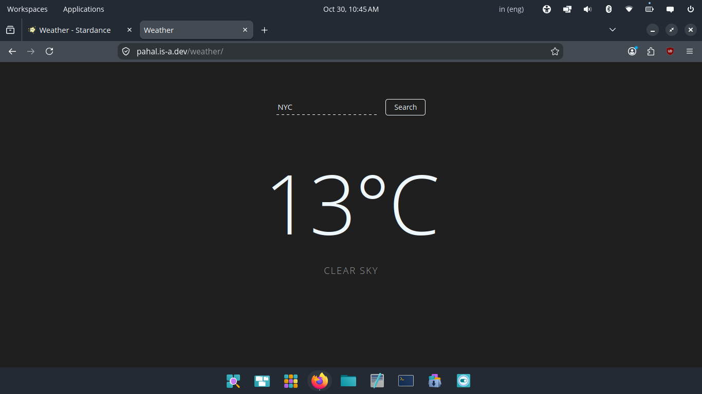

# Weather

## what is this?
This is a very minimal weather website. it simply shows current wweather of whatever city is entered.

## How to use it?
You can use it by entering the name of the city you want to see the weather of and click search

## How it works
* whenever you enter a city name, it sends a request to open meteo to fetch it's coordinates using open meteo geocoding api.
* The geocoding api then returns the coordinates of that place (or an error if that place isn't found.)
* These coordinates are again sent to open meteo to fetch weather info as a weather api request.
* Open meteo then returns the weather info which is dislpayed on the screen!

## Tech stack
I've used HTML, CSS and JavaScript to make this.

## Screenshot
